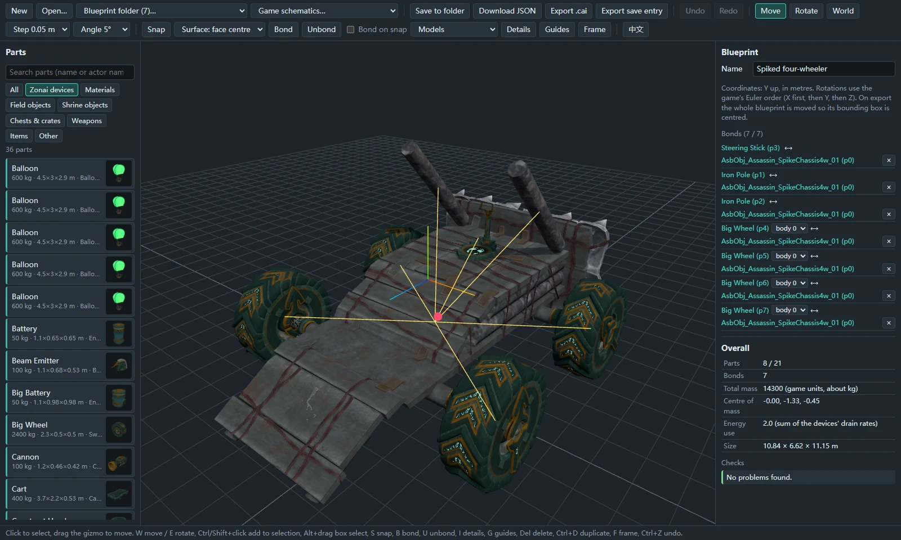
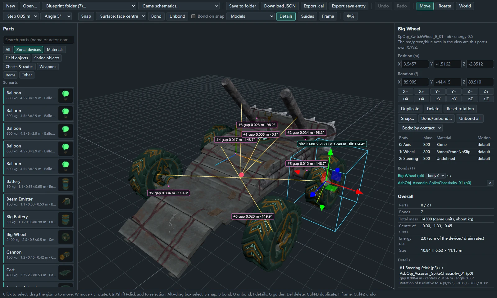
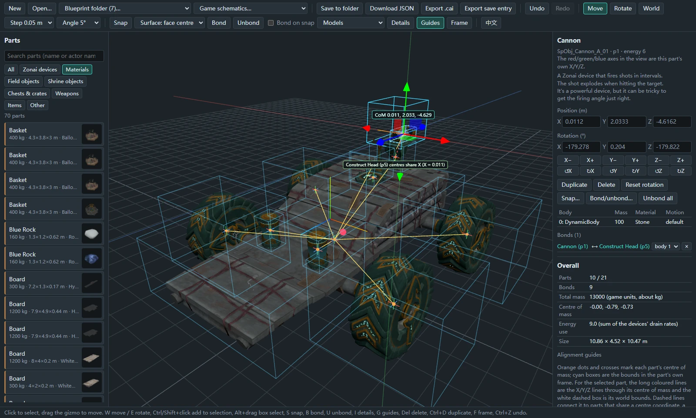

<div align="center">

# Zelda TotK Blueprint Editor

**Design Ultrahand builds for *Tears of the Kingdom* on your PC, then build them in the game with Autobuild.**

[](LICENSE)
[](https://github.com/Yanchen30247/zelda-totk-blueprint-editor/releases/latest)


English · [中文](README.zh-CN.md)



</div>

## About

Building in the game is great until you want something precise: a wheel that's actually centred, two fans that are
actually parallel, a frame that's actually square. This editor lets you lay the parts out with a mouse and numbers,
snap them together on the same snap points the game uses, and set up the bonds. It saves the result in the game's own
schematic format. A small tool then writes it into the Autobuild history of your save, so the next time you load the
save it's right there in the Autobuild menu.

No game files are included in this repository or in the release packages. The part library, models and textures are
extracted from your own copy of the game, on your own machine.

## Features

- **About 1,400 parts.** Everything Ultrahand can pick up and glue: Zonai devices, building materials, shrine objects,
  chests, weapons and more, with their real collision shapes, masses, snap points and joints.
- **Precise placement.** Gizmo or typed values, step snapping for position and angle, align and distribute for groups.
- **Snapping that matches the game.** Click a snap point or any surface on one part, then on another, and they meet
  face to face.
- **Bonds you can trust.** The editor records which body of a multi-body part (a big wheel's axle, rim or steering)
  each bond holds, and warns when that doesn't match what's actually touching. Getting it wrong is how an axle ends up
  on the wrong side in the game.
- **Measurements.** Gaps and angles of every bond, centres of mass, and guides that show what lines up with what.
- **Real models** with the game's textures (optional), or collision shapes.
- **The game's 46 schematics** can be opened and used as a starting point.
- **Save import** with a backup first and a read-back check after.
- **English and Chinese**, switchable in the toolbar.

<table>
  <tr>
    <td width="50%"></td>
    <td width="50%"></td>
  </tr>
  <tr>
    <td align="center"><sub>Details (I): gap and angle of every bond, and the selected part's bodies</sub></td>
    <td align="center"><sub>One of the game's schematics, with alignment guides (G)</sub></td>
  </tr>
</table>

## Getting started

### From a release

Download a package from [Releases](https://github.com/Yanchen30247/zelda-totk-blueprint-editor/releases/latest):

| Package | What's in it |
|---|---|
| `zelda-totk-blueprint-editor-<version>-win-x64-portable.zip` | Everything, including Node.js. Unzip and go. Windows only. |
| `zelda-totk-blueprint-editor-<version>.zip` | The same without Node.js. Needs Node.js 22.15+ installed; the editor also runs on Linux and macOS. |

Then:

1. **`setup.cmd`** asks where the game's RomFS is (the extracted folder with `Pack/` and `Model/` in it) and,
   optionally, where your saves are. It remembers both in `config.json` and builds the part library.
2. **`editor.cmd`** starts the editor and opens it in your browser. Keep its window open while you work.
3. **`import-blueprint.cmd`** puts a blueprint into your save (close the game first). See
   [Putting a blueprint in your save](#putting-a-blueprint-in-your-save).

Without Windows, run the same steps with Node: `node tools/setup.js`, then `node app/server/serve.mjs --open`.

### From source

```powershell
git clone https://github.com/Yanchen30247/zelda-totk-blueprint-editor.git
cd zelda-totk-blueprint-editor
node tools/setup.js
npm --prefix app install
npm --prefix app run dev
```

Then open http://localhost:5175.

### 3D models (optional)

Without models the editor draws collision shapes. The game compresses its meshes with
[MeshCodec](https://github.com/dt-12345/MeshCodec), so build that once in WSL. It's GPL-2.0 and stays a separate
program that this project only runs:

```powershell
wsl -d Ubuntu-24.04 -- bash -lc "git clone --recursive --depth 1 --shallow-submodules https://github.com/dt-12345/MeshCodec ~/meshcodec && cd ~/meshcodec && cmake -B build . -DCMAKE_BUILD_TYPE=Release -DZSTD_BUILD_SHARED=OFF -DZSTD_BUILD_PROGRAMS=OFF -DZSTD_STATIC_LINKING_ONLY=ON -DBUILD_TESTING=ON && cmake --build build -j8"
```

```powershell
node tools/build_models.js
```

(In the portable package, use `node\node.exe tools\build_models.js`.) This writes models with base colour, emissive and
cut-out textures. It also reads the rest pose of multi-body parts from their skeletons, and the big wheel's axle
animations, so the editor shows the axle on the side the game will put it.

## Using the editor

Click a part in the library to add it next to the selected one; search works on English, Chinese and actor names. Part
names come from the game's own text. A few hundred objects are never named in the game; in English they're listed by
their actor ID.

| Key | Action |
|---|---|
| <kbd>W</kbd> / <kbd>E</kbd> | Move / rotate with the gizmo |
| <kbd>S</kbd> | Snap: click a snap point or surface on the part to move, then on the target. <kbd>R</kbd> turns it 90° |
| <kbd>B</kbd> / <kbd>U</kbd> | Bond / unbond: with a part selected, click the other part |
| <kbd>I</kbd> | Details: gaps, angles, sizes |
| <kbd>G</kbd> | Guides: centres of mass and alignments |
| <kbd>F</kbd> | Frame the build |
| <kbd>Ctrl</kbd>/<kbd>Shift</kbd>+click, <kbd>Alt</kbd>+drag | Select several parts |
| <kbd>Ctrl</kbd>+<kbd>D</kbd>, <kbd>Del</kbd> | Duplicate, delete |
| <kbd>Ctrl</kbd>+<kbd>Z</kbd> / <kbd>Ctrl</kbd>+<kbd>Y</kbd> | Undo / redo |
| <kbd>Esc</kbd> | Leave the current mode, or clear the selection |

The panel on the right takes typed positions and angles. With several parts selected it has group move and rotate,
align to the primary part, distribute, and "bond together". The checks at the bottom right catch the usual mistakes:
more than 21 parts, parts that aren't connected, bonded parts too far apart, bonds on the wrong body.

"Save to folder" writes `<name>.json` (editor format) and `<name>.cai` (game format) to the blueprint folder. You can
also drop a file on the window, or open one of the game's schematics from the toolbar.

## Putting a blueprint in your save

Close the game first. Double-click `import-blueprint.cmd`: the window lists the `.cai` files in the blueprint folder
(or drop files on it), shows the Autobuild history of the chosen save slot, and imports the one you pick. The window is
in Chinese for now. From the command line:

```powershell
node tools/save_inject.js --list
node tools/save_inject.js my-car.cai
node tools/save_inject.js my-car.cai --write
```

Without `--write` it's a dry run. It uses the slot you saved to last unless you pass `--slot 03`. Before writing, both
files of the slot are copied to `backups/<time>/`; the new files are written through a temporary file and a rename,
then read back and checked. Load that save and the blueprint is at the top of the Autobuild history.

The game caches one picture per history entry (`Draft_<n>.png`) and reuses it whenever a picture with that number
exists, so the tool gives new entries a number that has none. If your setup keeps that cache somewhere other than
`cache/0/icon` next to the save folder, set `iconDir`.

## Configuration

`setup.cmd` writes `config.json` in the project folder. You can edit it by hand, or override any entry with an
environment variable:

| `config.json` | Environment variable | What it is | Default |
|---|---|---|---|
| `romfs` | `TOTK_ROMFS` | RomFS: the extracted folder, or one with `romfs.bin` + `index.json` | the game folder |
| `install` | `TOTK_INSTALL` | Game folder | `zelda_king` next to the project |
| `saveRoot` | `TOTK_SAVE_ROOT` | Folder with `slot_00`, `slot_01` ... (or one account folder holding them) | `profile/save` in the game folder |
| `iconDir` | `TOTK_ICON_DIR` | The game's Autobuild picture cache | `cache/0/icon` next to the save folder |
| `blueprintDir` | `BLUEPRINT_DIR` | The editor's blueprint folder | `blueprint/` in the game folder, else `blueprints/` |
| `backupRoot` | `TOTK_BACKUP_ROOT` | Where save backups go | `backups/` |

`MESHCODEC` and `WSL_DISTRO` set where MeshCodec's `mc_test` is in WSL (default `~/meshcodec/build/tests/mc_test`)
and which distro to use (default `Ubuntu-24.04`).

## How it works

A schematic (`CmbAct`) holds up to 21 parts, each with an actor name and a 3×4 pose for each of its bodies, and up to
21 bonds, each naming two parts and which body of each is glued. Bond positions aren't stored at all; the game works
them out when it builds. The Autobuild history in `progress.sav` keeps up to 30 of these, plus some bookkeeping.
[docs/formats.md](docs/formats.md) has the details (in Chinese, but the offset tables are most of it).

All the formats involved (SARC, BYML, MSBT, BFRES, TexToGo textures, the save file) are read with plain JavaScript in
[`tools/lib/`](tools/lib). MeshCodec is the only outside program.

| Command | |
|---|---|
| `node tools/dump_actor.js <Actor>` | Dump an actor pack's parameters as JSON |
| `node tools/dump_pack.js <path> <out> [filter]` | Dump a shared pack or a single BYML file |
| `node tools/flat.js <json> [regex]` | Flatten JSON into `key=value` lines |
| `npm --prefix app test` | Tests: all 46 game schematics round-trip, snapping, Euler order, bond bodies |

## Limitations

- This edits your save. It backs up first and checks what it wrote, but keep your own backups too.
- Developed against game version 1.4.x. Blueprints written this way show up and build in game; not every part in
  the library has been tried in a build.
- A few things are still educated guesses, such as what some save fields mean and whether the game accepts bonds that
  form a loop. docs/formats.md marks them.
- The import window is Chinese only for now.

Bug reports and pull requests are welcome.

## License

[GPL-3.0](LICENSE). The portable package also contains Node.js, under its own license (`node/LICENSE`).

This is a fan project with no connection to Nintendo. Please don't publish files extracted from the game.
