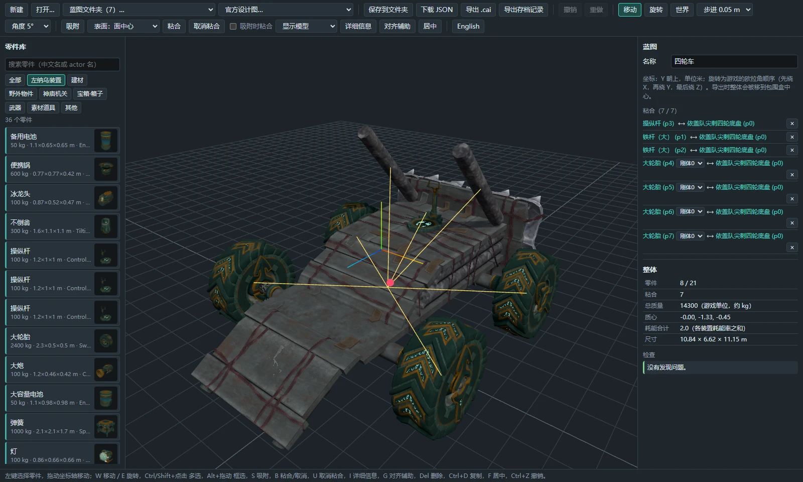
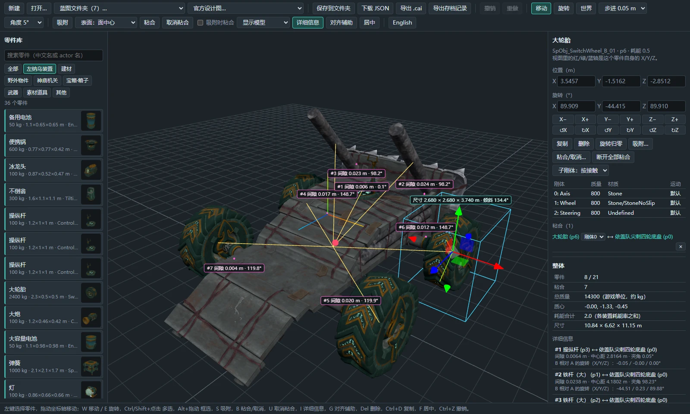
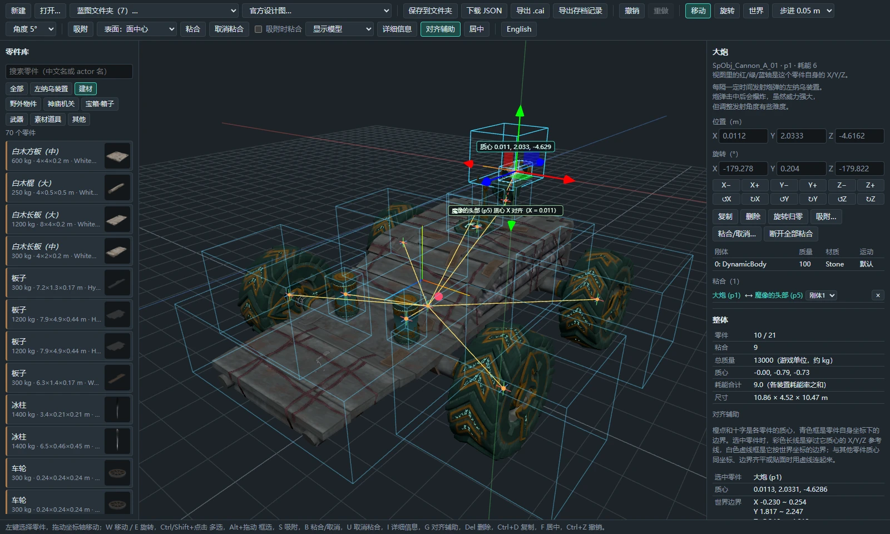

<div align="center">

# Zelda TotK Blueprint Editor

**在电脑上设计《王国之泪》的究极手载具，然后在游戏里用究极建造直接造出来。**

[](LICENSE)
[](https://github.com/Yanchen30247/zelda-totk-blueprint-editor/releases/latest)


[English](README.md) · 中文



</div>

## 简介

在游戏里搭东西很好玩，但想做得精确就难了：轮子要正好居中，两个风扇要真的平行，车架要方方正正。这个编辑器让你用鼠标和数字摆零件，
用和游戏一样的吸附点把零件对上，设置好粘合，然后存成游戏自己的设计图格式。再用一个小工具把它写进存档的究极建造历史，
下次读档，在究极建造菜单里就能直接造。

仓库和 Release 包里都没有任何游戏文件。零件库、模型和贴图都是在你自己的电脑上，从你自己的游戏里提取的。

## 功能

- **约 1400 个零件**：究极手能抓起来粘的东西基本都有，左纳乌装置、建材、神庙机关、宝箱、武器等等，带真实的碰撞体、质量、吸附点和关节。
- **精确摆放**：拖坐标轴或直接输入数值，位置和角度都能按步进对齐，多个零件可以整体对齐、等距分布。
- **和游戏一致的吸附**：在一个零件上点吸附点或任意表面，再点另一个零件，两个面就贴在一起。
- **靠谱的粘合**：多刚体零件（比如大轮胎的车轴、轮胎、转向）粘的是哪个刚体会被记录下来，和实际接触不一致时会提示。
  记错了，游戏里车轴就会伸到错的那一侧。
- **测量**：每条粘合的间隙和夹角、质心，以及哪些零件互相对齐。
- **真实模型**：带游戏贴图（可选），也可以只看碰撞体。
- **游戏自带的 46 张设计图**可以直接打开，在它们的基础上改。
- **导入存档**：写入前先备份，写完读回来检查。
- **中英文界面**，工具栏一键切换。

<table>
  <tr>
    <td width="50%"></td>
    <td width="50%"></td>
  </tr>
  <tr>
    <td align="center"><sub>详细信息（I）：每条粘合的间隙和夹角，以及选中零件的各个刚体</sub></td>
    <td align="center"><sub>游戏自带的设计图，开着对齐辅助（G）</sub></td>
  </tr>
</table>

## 开始使用

### 用 Release 包

在 [Releases](https://github.com/Yanchen30247/zelda-totk-blueprint-editor/releases/latest) 下载：

| 包 | 内容 |
|---|---|
| `zelda-totk-blueprint-editor-<版本>-win-x64-portable.zip` | 全部都有，包括 Node.js，解压就能用。仅限 Windows。 |
| `zelda-totk-blueprint-editor-<版本>.zip` | 同上但不带 Node.js，需要自己装 Node.js 22.15+；编辑器在 Linux、macOS 上也能跑。 |

然后：

1. **`setup.cmd`**：问你游戏 RomFS 在哪（解包后的文件夹，里面有 `Pack/` 和 `Model/`），以及（可选）存档在哪，
   记到 `config.json` 里，然后生成零件库。
2. **`editor.cmd`**：启动编辑器并在浏览器里打开。用的时候别关这个窗口。
3. **`import-blueprint.cmd`**：把蓝图写进存档（先退出游戏），见下面的[写进存档](#写进存档)。

不在 Windows 上的话，用 Node 跑同样的步骤：`node tools/setup.js`，然后 `node app/server/serve.mjs --open`。

### 从源码运行

```powershell
git clone https://github.com/Yanchen30247/zelda-totk-blueprint-editor.git
cd zelda-totk-blueprint-editor
node tools/setup.js
npm --prefix app install
npm --prefix app run dev
```

然后打开 http://localhost:5175 。

### 3D 模型（可选）

没有模型时编辑器画的是碰撞体。游戏的网格数据用 [MeshCodec](https://github.com/dt-12345/MeshCodec) 压缩过，
需要先在 WSL 里编译一次。它是 GPL-2.0 的独立程序，本项目只是调用它：

```powershell
wsl -d Ubuntu-24.04 -- bash -lc "git clone --recursive --depth 1 --shallow-submodules https://github.com/dt-12345/MeshCodec ~/meshcodec && cd ~/meshcodec && cmake -B build . -DCMAKE_BUILD_TYPE=Release -DZSTD_BUILD_SHARED=OFF -DZSTD_BUILD_PROGRAMS=OFF -DZSTD_STATIC_LINKING_ONLY=ON -DBUILD_TESTING=ON && cmake --build build -j8"
```

```powershell
node tools/build_models.js
```

（便携包里用 `node\node.exe tools\build_models.js`。）它会生成带固有色、自发光和镂空贴图的模型，还会从骨架读出多刚体零件的
静止位置，以及大轮胎的车轴动画，编辑器就能把车轴画在游戏实际会伸出的那一侧。

## 编辑器怎么用

在零件库里点一下就加进来，放在选中零件旁边；搜索支持中文名、英文名和 actor 名。零件名优先用游戏自己的文本；
有几百个东西游戏里没起名字，中文界面里大多照着 actor 名手动起了名字（显示为斜体）。

| 按键 | 作用 |
|---|---|
| <kbd>W</kbd> / <kbd>E</kbd> | 用坐标轴移动 / 旋转 |
| <kbd>S</kbd> | 吸附：先点要移动的零件上的吸附点或表面，再点目标零件。<kbd>R</kbd> 转 90° |
| <kbd>B</kbd> / <kbd>U</kbd> | 粘合 / 取消粘合：选中一个零件后点另一个零件 |
| <kbd>I</kbd> | 详细信息：间隙、夹角、尺寸 |
| <kbd>G</kbd> | 对齐辅助：质心和对齐关系 |
| <kbd>F</kbd> | 视图居中 |
| <kbd>Ctrl</kbd>/<kbd>Shift</kbd>+点击，<kbd>Alt</kbd>+拖动 | 多选 |
| <kbd>Ctrl</kbd>+<kbd>D</kbd>，<kbd>Del</kbd> | 复制，删除 |
| <kbd>Ctrl</kbd>+<kbd>Z</kbd> / <kbd>Ctrl</kbd>+<kbd>Y</kbd> | 撤销 / 重做 |
| <kbd>Esc</kbd> | 退出当前模式，或取消选择 |

右侧面板可以直接输入位置和角度。多选时有整体平移旋转、对齐到主零件、等距分布、"粘成整体"。右下角的检查栏会提示常见问题：
超过 21 个零件、零件没连成一体、粘合的零件离得太远、粘合记错了刚体。

"保存到文件夹"会在蓝图文件夹里写 `<名称>.json`（编辑器格式）和 `<名称>.cai`（游戏格式）。也可以把文件拖进窗口，
或者从工具栏打开游戏自带的设计图。

## 写进存档

先退出游戏。双击 `import-blueprint.cmd`：窗口左边列出蓝图文件夹里的 `.cai`（也可以把文件拖进去），右边显示所选存档槽的
究极建造历史，选好点"导入到存档"。也可以用命令行：

```powershell
node tools/save_inject.js --list
node tools/save_inject.js my-car.cai
node tools/save_inject.js my-car.cai --write
```

不加 `--write` 只是试运行。默认用最近保存的存档槽，`--slot 03` 可以指定。写入前会把这个槽的两个文件备份到
`backups/<时间>/`，写的时候先写临时文件再改名替换，写完读回来检查。读这个存档，蓝图就在究极建造历史的最前面。

游戏给每条历史缓存一张图（`Draft_<编号>.png`），只要这个编号的图存在就直接拿来用，所以工具给新条目的编号都是没有缓存图的。
如果你的缓存不在存档文件夹旁边的 `cache/0/icon`，设置 `iconDir`。

## 配置

`setup.cmd` 会在项目文件夹里写 `config.json`，可以手动改，每一项也都可以用环境变量覆盖：

| `config.json` | 环境变量 | 是什么 | 默认 |
|---|---|---|---|
| `romfs` | `TOTK_ROMFS` | RomFS：解包的文件夹，或含 `romfs.bin` + `index.json` 的文件夹 | 游戏目录 |
| `install` | `TOTK_INSTALL` | 游戏目录 | 项目旁边的 `zelda_king` |
| `saveRoot` | `TOTK_SAVE_ROOT` | 含 `slot_00`、`slot_01` 的文件夹（或只含一个账号文件夹的上一层） | 游戏目录的 `profile/save` |
| `iconDir` | `TOTK_ICON_DIR` | 究极建造缩略图缓存 | 存档文件夹旁边的 `cache/0/icon` |
| `blueprintDir` | `BLUEPRINT_DIR` | 编辑器的蓝图文件夹 | 游戏目录的 `blueprint/`，没有游戏目录时是项目里的 `blueprints/` |
| `backupRoot` | `TOTK_BACKUP_ROOT` | 存档备份放哪 | `backups/` |

`MESHCODEC` 和 `WSL_DISTRO` 指定 WSL 里 MeshCodec 的 `mc_test` 位置（默认 `~/meshcodec/build/tests/mc_test`）和用哪个发行版（默认 `Ubuntu-24.04`）。

## 原理

一张设计图（`CmbAct`）最多 21 个零件，每个零件记 actor 名和每个刚体的 3×4 位姿；最多 21 条粘合，每条记两个零件和各自粘的是哪个刚体。
粘合点的位置根本不存，游戏建造时自己算。`progress.sav` 里的究极建造历史最多存 30 张，外加一些记录信息。
详见 [docs/formats.md](docs/formats.md)。

涉及的格式（SARC、BYML、MSBT、BFRES、TexToGo 贴图、存档）都在 [`tools/lib/`](tools/lib) 里用纯 JavaScript 读取，外部程序只有 MeshCodec。

| 命令 | |
|---|---|
| `node tools/dump_actor.js <Actor>` | 把 actor 包里的参数导出成 JSON |
| `node tools/dump_pack.js <路径> <输出> [过滤]` | 导出公共包或单个 BYML 文件 |
| `node tools/flat.js <json> [正则]` | 把 JSON 展平成 `键=值` |
| `npm --prefix app test` | 测试：46 张官方设计图往返、吸附、欧拉角约定、粘合刚体 |

## 许可证

[GPL-3.0](LICENSE)。便携包里还带了 Node.js，它有自己的许可证（`node/LICENSE`）。

这是玩家自己做的项目，和任天堂没有关系。请不要公开发布从游戏里提取出来的文件。
